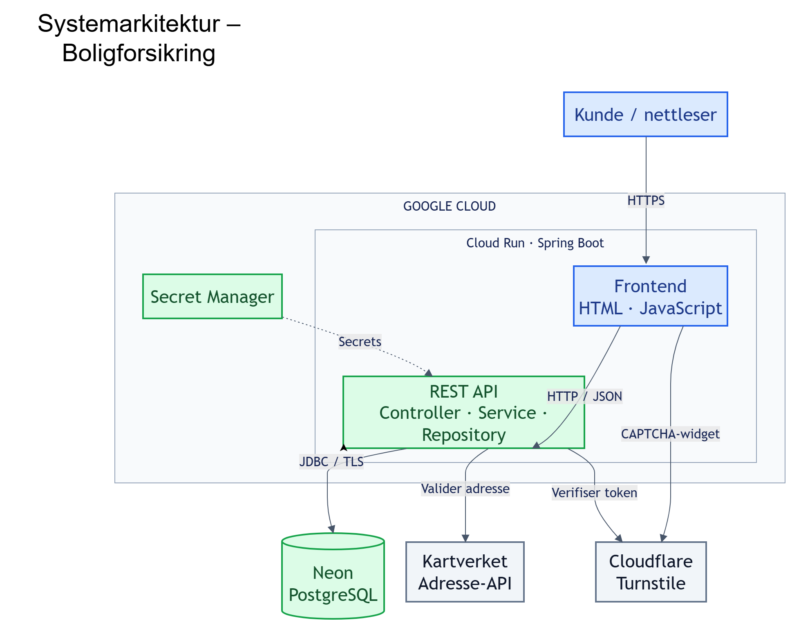
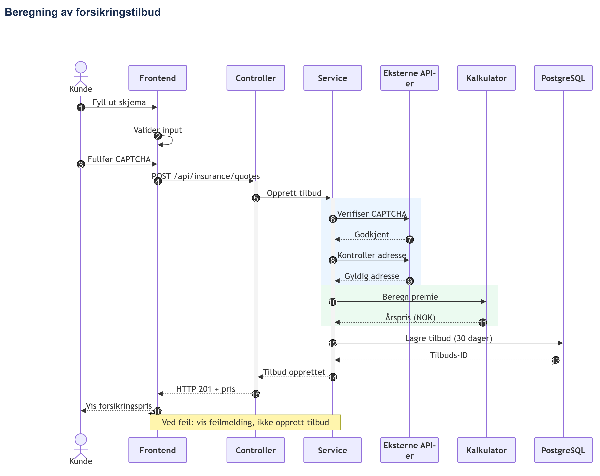

## Live demo

Applikasjonen er publisert på Google Cloud Run:

🔗 https://boligforsikring-288652911463.europe-north1.run.app

## Arkitektur og design

Prosjektet er dokumentert med to diagrammer:

### Systemarkitektur


### Sekvensdiagram – Beregn pris



# Boligforsikring – Priskalkulator

Dette er en enkel webapplikasjon jeg har laget med Java og Spring Boot. Brukeren kan fylle inn informasjon om boligen sin og få et estimat på hva boligforsikring kan koste.

Prosjektet demonstrerer utvikling av REST API-er, databasehåndtering, integrasjon med eksterne tjenester og implementering av forretningslogikk.

## Hva kan applikasjonen gjøre?

- Beregne månedlig og årlig prisestimat basert på boligens størrelse og byggeår.
- Kontrollere at adressen finnes ved hjelp av Kartverkets API.
- La brukeren be om å få tilbudet tilsendt på e-post.
- La brukeren be om å bli kontaktet av en rådgiver.
- Lagre tilbud og kontaktforespørsler i PostgreSQL.
- Kontrollere at tilbudet ikke er eldre enn 30 dager.
- Bruke Cloudflare Turnstile for å beskytte mot automatiserte forespørsler.

## Teknologier

- **Backend:** Java 17, Spring Boot
- **Frontend:** HTML, CSS, Bootstrap 5 og JavaScript
- **Database:** PostgreSQL med Spring JDBC
- **Eksterne tjenester:** Kartverket og Cloudflare Turnstile
- **Byggeverktøy:** Maven

## Hvordan fungerer det?

Brukeren legger inn adresse, boligareal og byggeår. Før prisen beregnes, sjekker backend at adressen finnes hos Kartverket.

Deretter beregnes et prisestimat som lagres i databasen. Brukeren kan velge å be om tilbudet på e-post eller sende en forespørsel om å bli kontaktet av en rådgiver.

Et tilbud er gyldig i 30 dager. Når et tilbud hentes eller noen prøver å be om det på e-post, sjekker backend om det har utløpt.

## Oppbygging

Jeg har delt backend inn i Controller, Service og Repository for å holde koden oversiktlig.

- **Controller** tar imot HTTP-forespørsler.
- **Service** håndterer validering, prisberegning og annen forretningslogikk.
- **Repository** håndterer lagring og uthenting fra PostgreSQL.

Frontend kommuniserer med backend gjennom REST API-er.

## Kjør prosjektet lokalt

Prosjektet krever Java 17, Maven og PostgreSQL. Databasetilkobling og Cloudflare Turnstile må konfigureres lokalt.

Start applikasjonen med:

```bash
mvn spring-boot:run
```

Åpne deretter `http://localhost:8080` i nettleseren.
